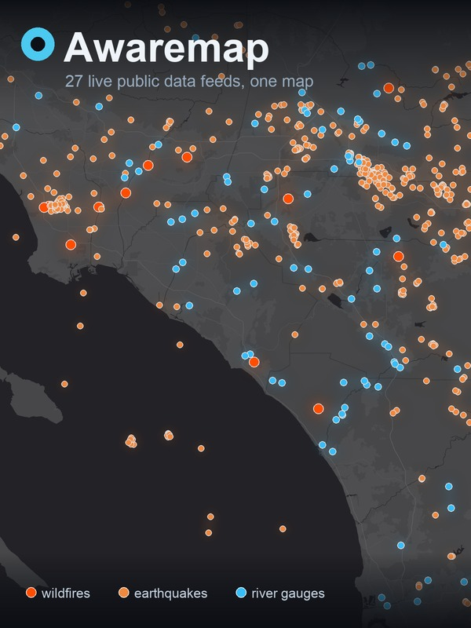

# Awaremap

**A map of what is actually happening around any point on Earth, built entirely from public data.**



Type a place — your street, or Manila — and Awaremap asks 27 public data sources what
is going on there right now: wildfires, earthquakes, tropical cyclone tracks, active
weather alerts, 911 and 311 calls, air quality, river flood levels, tides, aircraft
overhead, local news. Almost all of it is government data that was always public and
never in one place.

Every pin is labelled with the agency it came from, because the agencies don't always
agree. During the Norte Fire, CAL FIRE and the federal wildfire system reported
different containment figures for the same fire on the same morning.

## Why this exists

In September 2025, Super Typhoon Ragasa — one of the most powerful storms of the year —
hit the Philippines, Taiwan, Hong Kong and mainland China. Finding out what was actually
happening meant opening a dozen sites across four countries' agencies. I started building
one screen that would just tell you.

Then in October 2026 the **Norte Fire** started in the hills above San Clemente and burned
into San Juan Capistrano, California — the town my school is in. My school was evacuated
and eight families I know lost their homes. I opened the app I had been building and it
was already showing the fire: 570 acres, with the containment figure, 3.5 km away.

I built it for somewhere else and ended up needing it here.

## Running it

```bash
python3 serve.py 8777
```

Then open <http://localhost:8777>. No install, no build step, no API keys, no accounts.

Add `?demo` to the URL to skip the geolocation prompt and hold the default view.

`serve.py` does two jobs: it serves the static files, and it proxies the five data
sources that refuse browser CORS requests. In production that proxy is a Cloudflare
Pages Function instead (`functions/api/proxy.js`) — same URL, same allowlist.

## How it works

- **Front end** — vanilla JavaScript, no framework and no build step. Leaflet 1.9.4 for
  the map, Esri dark canvas basemap tiles (no API key required).
- **`app.js`** — one fetcher per data source, each returning the same item shape
  (`{id, cat, src, title, body, lat, lon, time, url}`). A registry fans all 27 out in
  parallel, and each one paints as soon as it lands, so a slow source can't stall the map.
  Nine scalar "pills" handle values rather than pins.
- **The Explore toggle** — the app opens showing safety layers only: alerts, wildfires,
  earthquakes, hazards, 911/311, air sensors, river gauges, traffic, news. Everything
  else — places, transit, bike share, photos, wildlife, aircraft — sits behind one button.
  A tool you open during a fire shouldn't lead with breweries.
- **The proxy** (`serve.py` / `functions/api/proxy.js`) — deliberately narrow: GET only,
  HTTPS only, five allowlisted hostnames. The first version forwarded any URL it was
  given, which made it an open relay anyone could point at any server. The allowlist is
  the fix.
- **Privacy** — no accounts, no database, no analytics, no cookies. Nothing is stored
  server-side. All feed text is escaped before rendering, since it is written by strangers.

## Data sources

NOAA/NWS alerts · USGS earthquakes · EMSC earthquakes · NASA EONET hazards · USGS volcano
alerts · NIFC wildfire incidents · NOAA SPC storm reports · Seattle, San Francisco, New
York, Chicago and Philadelphia open data · ADS-B aircraft · NOAA METARs · pilot reports ·
GDELT news · OpenStreetMap places, notes and changesets · Wikipedia · Wikimedia Commons ·
iNaturalist · GBIF · USGS water gauges · Open Brewery DB · Radio Browser · GBFS bike
share · MBTA and BART · sensor.community · RainViewer radar · Open-Meteo weather, air
quality, marine and GloFAS flood models · sunrisesunset.io · NOAA tides · NOAA space
weather · wheretheiss.at · Nominatim geocoding.

## Built with AI assistance

Claude (Anthropic) was used substantially while building this, and that is disclosed in
the Congressional App Challenge submission as the rules require. I directed the project —
what it should do, which sources mattered, what to cut — tested every version, found bugs
including a stale-position defect in the cyclone de-duplication and a basemap that only
worked on localhost, and deployed it myself.

## Licence

MIT.
